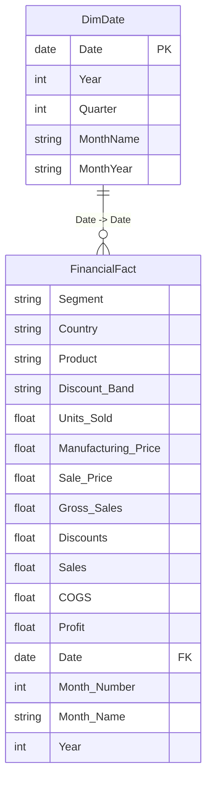

# Power BI Financial Data Model Documentation: Corporate & Margin Performance

## 1. Accounting Hierarchy & Data Architecture
The corporate financial model is structured around a verified single-grain fact table (`FinancialFact`) joined to a continuous calendar dimension table (`DimDate`).

---

## 2. Table Specifications & Accounting Invariance

### A. Fact Table: `FinancialFact`
- **Source**: `data/processed/financial_sample_cleaned.csv`
- **Grain**: One transaction record per Country, Segment, Product, and Month (700 rows).
- **Core Accounting Identity**:
  $$\text{Gross Sales} - \text{Discounts} = \text{Sales (Net)}$$
  $$\text{Sales (Net)} - \text{COGS} = \text{Profit}$$
- **Reconciliation Audit**: 100% of rows satisfy both accounting identities within 5 cents (accounting rounding tolerance from original Excel files).

### B. Handling of Budget / Target Fields
- **Audit Discovery**: The source workbook `financial_sample.xlsx` contains zero budget, plan, or target fields.
- **Methodological Standard**: Rather than inventing artificial target numbers, the model relies on historical prior-year baselines (`[Net Sales Previous Year]`, `[Profit Previous Year]`) and parameterized What-If simulation parameters.

---

## 3. What-If Parameter Specifications
To enable dynamic scenario testing in Power BI Desktop without changing source data, two disconnected parameter tables are defined:

1. **`Discount Shift` Parameter Table**:
   - DAX Generation: `GENERATESERIES(-0.30, 0.30, 0.05)`
   - Formatted as Percentage: `-30%` to `+30%`, Step `5%`.
   - Default Value: `0.0%`.
2. **`COGS Shift` Parameter Table**:
   - DAX Generation: `GENERATESERIES(-0.20, 0.20, 0.02)`
   - Formatted as Percentage: `-20%` to `+20%`, Step `2%`.
   - Default Value: `0.0%`.
