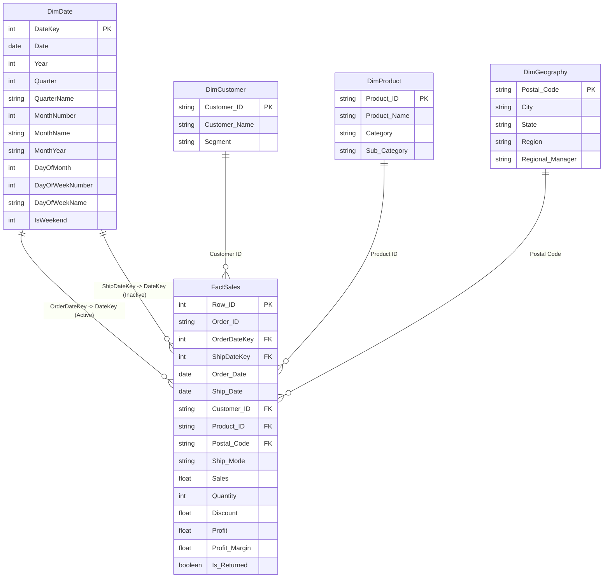

# Power BI Dimensional Model Documentation: Superstore Sales & Profit

## 1. Architectural Strategy: The Kimball Star Schema
To deliver sub-second analytical query performance, seamless time-intelligence calculations, and unambiguous filter propagation in Power BI Desktop, the transactional Superstore dataset has been decomposed into a classical **Kimball Star Schema**.

---

## 2. Table Specifications & Grain

### A. Fact Table: `FactSales`
- **File**: `data/processed/star_schema/FactSales.csv`
- **Grain**: One record per individual transaction line item (9,994 rows).
- **Primary Key**: `Row ID`.
- **Foreign Keys**: `OrderDateKey`, `ShipDateKey`, `Customer ID`, `Product ID`, `Postal Code`.
- **Numeric Measures**: `Sales`, `Quantity`, `Discount`, `Profit`, `Profit Margin`.
- **Operational Flag**: `Is Returned` (boolean, indicating if the order was returned).

### B. Dimension Table: `DimDate`
- **File**: `data/processed/star_schema/DimDate.csv`
- **Grain**: One record per calendar day (1,826 days from 2014-01-01 to 2018-12-31).
- **Role**: Continuous calendar table required for Power BI DAX Time-Intelligence functions (`DATEADD`, `TOTALYTD`, `SAMEPERIODLASTYEAR`).
- **Marked as Date Table**: `DimDate[Date]`.

### C. Dimension Table: `DimCustomer`
- **File**: `data/processed/star_schema/DimCustomer.csv`
- **Grain**: One record per unique customer (793 customers).
- **Primary Key**: `Customer ID`.
- **Attributes**: `Customer Name`, `Segment` (Consumer, Corporate, Home Office).

### D. Dimension Table: `DimProduct`
- **File**: `data/processed/star_schema/DimProduct.csv`
- **Grain**: One record per distinct product catalog SKU (1,862 products).
- **Primary Key**: `Product ID`.
- **Attributes**: `Product Name`, `Category` (Furniture, Office Supplies, Technology), `Sub-Category` (17 sub-categories).

### E. Dimension Table: `DimGeography`
- **File**: `data/processed/star_schema/DimGeography.csv`
- **Grain**: One record per postal code location (631 postal codes).
- **Primary Key**: `Postal Code` (formatted as 5-digit zero-padded string).
- **Attributes**: `City`, `State`, `Region` (Central, East, South, West), `Regional Manager` (Kelly Williams, Chuck Magee, Cassandra Brandow, Anna Andreadi).

---

## 3. Relationship Matrix

| From Table (Many Side `*`) | From Column | To Table (One Side `1`) | To Column | Cardinality | Cross Filter | State |
| :--- | :--- | :--- | :--- | :--- | :--- | :--- |
| `FactSales` | `OrderDateKey` | `DimDate` | `DateKey` | Many-to-One (`*:1`) | Single (`Dim` -> `Fact`) | **Active** |
| `FactSales` | `ShipDateKey` | `DimDate` | `DateKey` | Many-to-One (`*:1`) | Single (`Dim` -> `Fact`) | *Inactive* (invoked via `USERELATIONSHIP`) |
| `FactSales` | `Customer ID` | `DimCustomer` | `Customer ID` | Many-to-One (`*:1`) | Single (`Dim` -> `Fact`) | **Active** |
| `FactSales` | `Product ID` | `DimProduct` | `Product ID` | Many-to-One (`*:1`) | Single (`Dim` -> `Fact`) | **Active** |
| `FactSales` | `Postal Code` | `DimGeography` | `Postal Code` | Many-to-One (`*:1`) | Single (`Dim` -> `Fact`) | **Active** |

---

## 4. Modeling Justifications & Integrity Guarantees
1. **No Bidirectional Filtering**: All relationships use single-direction filtering (`Dim` -> `Fact`). This eliminates circular filter paths and performance degradation.
2. **Zero Orphan Foreign Keys**: Automated assertions confirm that 100% of foreign keys in `FactSales` exist in their respective dimension tables.
3. **Continuous Calendar**: Spans 5 complete calendar years without gaps, ensuring DAX `DATEADD` and `PARALLELPERIOD` compute deterministic results.
